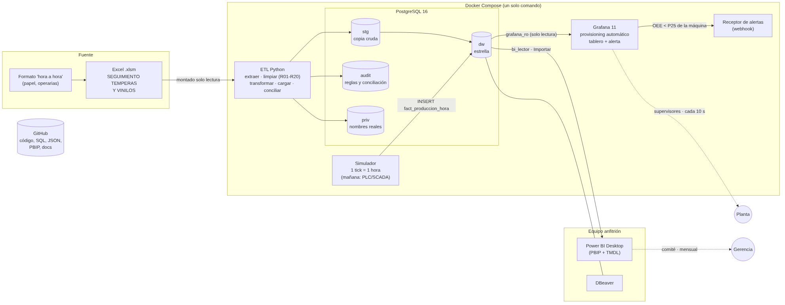

# BI de producción y paros · Líneas de envasado de vinilos y témperas

Solución de Inteligencia de Negocios de extremo a extremo para las cuatro líneas de envasado (Vinilos_1 a Vinilos_4). Toma el registro histórico de producción y paros que hoy vive en un Excel con macros (procedimiento P-MTO-22), lo limpia y lo carga en un **modelo dimensional en PostgreSQL**, y lo publica en dos capas:

- **Power BI** (analítico, para el comité mensual): OEE, Pareto de causas con drill-down código → sistema → componente y comparativos entre años.
- **Grafana** (operativo, casi en tiempo real): estado por máquina hora a hora y **alerta cuando el OEE de una máquina cae a su peor cuartil histórico**.

Todo el servidor (base de datos, ETL, simulador y Grafana) se levanta con **un solo comando** usando Docker.



## Resultados principales

| | 2022 | 2023 | 2024 | 2025 (ene-mar) |
|---|---:|---:|---:|---:|
| OEE | 71,3 % | 66,4 % | 73,3 % | 73,6 % |
| Disponibilidad | 91,7 % | 84,8 % | 80,7 % | 78,3 % |

El ajuste operativo y la limpieza por derrame explican el **59 %** del tiempo de paro no planificado, y ambos se concentran en el **sistema de dosificación**. Ver [hallazgos y recomendaciones](docs/08_hallazgos_y_recomendaciones.md).

---

## Reproducir la solución desde cero

### Requisitos
- Docker Desktop (o Docker Engine + Compose v2)
- Para el análisis, en el equipo anfitrión: Power BI Desktop y DBeaver

### Pasos
```bash
git clone <url-del-repositorio> && cd bi-vinilos-oee

# 1. Credenciales (cambiar todas las contraseñas)
cp .env.example .env

# 2. Fuente: copiar el Excel (no se versiona porque contiene nombres de personas)
#    data/raw/SEGUIMIENTO_TEMPERAS_Y_VINILOS_Actividad.xlsm

# 3. Levantar todo
docker compose up -d --build
```

Qué ocurre, en orden:

1. **`db`**: PostgreSQL 16 arranca y, la primera vez, crea los roles de solo lectura (`db/init/00_roles.sh`).
2. **`etl`**: cuando la base responde, borra y recrea los esquemas (`sql/ddl/01..06`), carga staging, dimensiones y hechos, concilia los totales y termina. Tarda unos 15 s.
3. **`simulador`** y **`grafana`**: arrancan solo si el ETL terminó bien. Grafana ya trae la fuente de datos, el tablero y la regla de alerta (*provisioning*), así que no hay que configurar nada a mano.

Verificación:
```bash
docker compose ps                 # db, grafana, simulador y alertas "running"; etl "exited (0)"
docker compose logs etl           # reglas de calidad aplicadas y filas cargadas
docker compose logs -f simulador  # una hora simulada cada 30 s por máquina
```

| Servicio | Acceso |
|---|---|
| Grafana | http://localhost:3000 (usuario y clave: `GF_SECURITY_ADMIN_*` del `.env`). Abre directamente el tablero *Monitoreo de líneas de envasado (OEE)* |
| PostgreSQL (DBeaver) | `localhost:5432`, base `bi_vinilos`, usuario `etl_admin` (administración) o `bi_lector` (consulta) |
| Power BI | Ver [`powerbi/README.md`](powerbi/README.md): conexión con `bi_lector`, modelo, medidas DAX y valores de control |

### Demostración en vivo de la alerta
```bash
docker compose exec simulador python forzar_falla.py Vinilos_3 6   # 6 horas simuladas en falla
docker compose logs -f alertas                                     # aquí llega la notificación
```
En 1 a 2 minutos el OEE de Vinilos_3 cae en el tablero, la regla pasa a *Pending* y luego a *Firing*. Al terminar la falla vuelve a *Normal* y llega el aviso "RESOLVED".

### Otras operaciones
```bash
docker compose run --rm etl        # volver a cargar desde cero (por ejemplo, con un Excel nuevo)
docker compose down                # detener (los datos se conservan en los volúmenes)
docker compose down -v             # detener y BORRAR los volúmenes: arranque totalmente limpio
```

Para correr el ETL sin Docker (contra un PostgreSQL local):
```bash
pip install -r etl/requirements.txt
cd etl/src && PGHOST=localhost POSTGRES_DB=bi_vinilos POSTGRES_USER=... POSTGRES_PASSWORD=... python -m etl.main
python -m etl.diccionario   # regenera docs/05_diccionario_datos.md desde el catálogo
```

---

## Estructura del repositorio

```
├── docker-compose.yml            Orquestación: db, etl, simulador, alertas, grafana
├── .env.example                  Variables de entorno (copiar a .env; .env NO se versiona)
├── db/init/00_roles.sh           Roles de mínimo privilegio (bi_lector, grafana_ro, simulador)
├── sql/
│   ├── ddl/                      01 esquemas · 02 dimensiones · 03 hechos · 04 índices · 05 vistas · 06 auditoría y permisos
│   └── consultas/consultas_analiticas.sql   12 consultas de negocio (agregaciones, funciones de ventana, comparativos)
├── etl/
│   ├── Dockerfile, requirements.txt
│   ├── config/                   Mapeos editables: turnos, clasificación OEE de códigos, alias, subcódigos, motivos
│   └── src/etl/                  extract · transform · load · conciliacion · fechas · calidad · diccionario · main
├── simulador/                    Streaming hora a hora, forzar_falla.py, receptor de alertas (webhook)
├── grafana/
│   ├── provisioning/             datasources · dashboards · alerting (se cargan solos al iniciar)
│   └── dashboards/monitoreo_lineas.json
├── powerbi/                      README (formato PBIP, modelo, páginas), medidas.dax, proyecto .pbip
├── data/raw/                     Excel fuente (ignorado por Git)
└── docs/                         Documentación (abajo) + generados/ (reporte del ETL) + img/
```

## Documentación

| # | Documento | Contenido |
|---|---|---|
| 1 | [Stakeholders y preguntas](docs/01_stakeholders_y_preguntas.md) | Usuarios, preguntas de negocio, capa y frecuencia |
| 2 | [Diagnóstico de la fuente](docs/02_diagnostico_fuente.md) | Estructura del Excel, 20 problemas de calidad, limitaciones del reporte actual |
| 3 | [Catálogo de indicadores](docs/03_catalogo_indicadores.md) | Indicadores del P-MTO-22 + OEE y nuevos indicadores; umbral de la alerta |
| 4 | [Modelo dimensional](docs/04_modelo_dimensional.md) | Estrella, grano, dimensiones y jerarquías, código → subcódigo, matriz de bus, SCD |
| 5 | [Diccionario de datos y linaje](docs/05_diccionario_datos.md) | Cada tabla y columna: tipo, llaves, origen y regla de transformación |
| 6 | [ETL, calidad y conciliación](docs/06_etl_y_calidad.md) | Herramienta, flujo, reglas R01-R20 y conciliación de totales |
| 7 | [Arquitectura y operación](docs/07_arquitectura_y_operacion.md) | Arquitectura, Power BI vs. Grafana, evolución a PLC/SCADA, datos personales y seguridad |
| 8 | [Hallazgos y recomendaciones](docs/08_hallazgos_y_recomendaciones.md) | Guion de la sustentación |
| — | [Reporte generado por el ETL](docs/generados/calidad_y_conciliacion.md) | Conteos antes y después de la última corrida |
| — | [Guía del equipo](docs/guia_equipo.md) | Plan de commits, checklist del PDF y ensayo de la sustentación |

## Decisiones técnicas clave

- **PostgreSQL**: funciones de ventana completas, BRIN para series de tiempo, índices parciales e integración nativa con Grafana y Power BI.
- **Esquema estrella** con jerarquía de causas aplanada (ver doc. 4).
- **OEE como cociente de sumas** en SQL y en DAX, nunca como promedio de porcentajes.
- **Power BI en formato PBIP + TMDL**: es texto, así que Git muestra las diferencias, y no guarda datos.
- **Grafana con *provisioning***: el tablero, la fuente de datos y la alerta son código versionado; la interfaz no permite editarlos (`allowUiUpdates: false`).
- **Seguridad**: seudónimos en el DW, nombres reales en un esquema restringido, un rol por consumidor y secretos fuera de Git.

## Equipo

| Integrante | Aportes principales |
|---|---|
| _Nombre 1_ | _p. ej. ETL, modelo dimensional, SQL_ |
| _Nombre 2_ | _p. ej. Power BI, Grafana, Docker, documentación_ |
