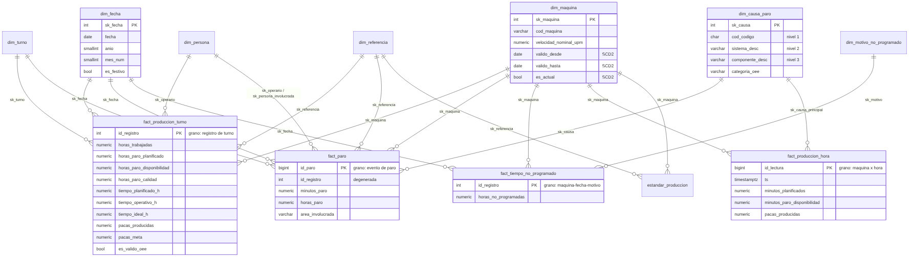

# 4. Modelo dimensional

## 4.1 Elección: **esquema estrella** (constelación de 4 hechos que comparten dimensiones conformadas)

| Criterio | Estrella ✅ | Copo de nieve |
|---|---|---|
| Consultas de BI | 1 join por dimensión; el SQL y el DAX son más simples | Cadenas de joins (código → sistema → componente) |
| Power BI | Recomendado por Microsoft (VertiPaq comprime bien dimensiones anchas; los filtros viajan en una dirección) | Más tablas, relaciones encadenadas, ambigüedad |
| Volumen de las dimensiones | Diminuto (4 máquinas, 66 causas, 61 referencias): la redundancia no cuesta nada | Ahorra espacio que no hace falta |
| Mantenimiento | Jerarquía editable en un solo lugar del ETL | — |

La única tabla "satélite" es `estandar_produccion` (máquina × referencia): **no** es una dimensión de análisis sino una tabla de referencia que el ETL usa para calcular el tiempo ideal; los hechos ya guardan el resultado (`tiempo_ideal_h`, `pacas_meta`).

## 4.2 Tablas de hechos y su grano

| Hecho | Grano (una fila = …) | Tipo | Filas | Medidas |
|---|---|---|---:|---|
| `fact_produccion_turno` | **un registro de turno**: una máquina, en una fecha, en un turno, con una operaria y una referencia (fila "Ingreso total" del Excel) | Transaccional | 4.742 | horas trabajadas, paros planificados / de disponibilidad / de calidad, tiempos planificado / operativo / ideal, pacas, pacas meta, nº eventos |
| `fact_paro` | **un evento de paro**: una celda "Código N" con minutos > 0, asociada al nivel más fino conocido de código → sistema → componente | Transaccional | 16.490 | minutos, horas, (conteo) |
| `fact_tiempo_no_programado` | **un registro de horas no trabajadas** de una máquina en una fecha por un motivo | Transaccional | 2.147 | horas no programadas |
| `fact_produccion_hora` | **una máquina × una hora** de producción (streaming del simulador; mañana, del PLC) | Transaccional, solo inserción | continuo | minutos planificados, minutos de paro, pacas, pacas-hora ideal |

`id_registro` es una **dimensión degenerada** (la fila de origen en el Excel): sirve para el linaje y para pasar de un paro a su turno (*drill-across*).

## 4.3 Dimensiones, atributos y jerarquías

| Dimensión | Llave sustituta / natural | Atributos principales | Jerarquía | SCD |
|---|---|---|---|---|
| **`dim_fecha`** ⭐ *construida por el equipo* | `sk_fecha` (AAAAMMDD) / `fecha` | año, semestre, trimestre, mes, semana ISO, día de la semana, fin de semana, **festivo de Colombia** (Ley Emiliani, calculado con la fecha de Pascua, incluido el nuevo festivo de 2026), día hábil | Año › Semestre › Trimestre › Mes › Día · Año ISO › Semana › Día | Tipo 0 (no cambia) |
| `dim_maquina` | `sk_maquina` / `cod_maquina` | nombre, línea, velocidad nominal (u/min), factor de eficiencia, vigencia | Línea › Máquina | **Tipo 2** (ver 4.6) |
| `dim_turno` | `sk_turno` / `cod_turno` | nombre, hora inicio/fin, duración, minutos de paro programado estándar, tipo de jornada, franja | Franja › Turno | Tipo 1 |
| `dim_persona` (rol: operaria y persona involucrada) | `sk_persona` / `cod_persona` (seudónimo) | rol, alias público | Rol › Persona | Tipo 1 |
| `dim_referencia` | `sk_referencia` / `cod_referencia` | marca, tamaño cc, n.º colores, familia de tamaño | Familia › Marca › Referencia | Tipo 1 |
| `dim_causa_paro` | `sk_causa` / `cod_causa` | código, descripción, área de impacto, **categoría OEE**, es planificado, sistema, componente, nivel | **Código › Sistema › Componente** | Tipo 1 |
| `dim_motivo_no_programado` | `sk_motivo` / `cod_motivo` | motivo estándar, responsable, observación, es controlable | Responsable › Motivo › Observación | Tipo 1 |

Todas tienen un **miembro desconocido** (`sk = -1`, "No registrado") para que ningún hecho quede con llave foránea nula.

## 4.4 Cómo se modela la jerarquía código → subcódigo

En la fuente la jerarquía es **irregular** (*ragged*):

- Código 01: tres niveles (`1.2` Sistema de dosificación → `1.2.C` Cambio de válvula).
- Códigos 03 y 05: dos niveles (`5.2` Sistema de dosificación de pintura).
- Los otros 15 códigos: un solo nivel (sin subcódigo).
- Además el subcódigo de algunos paros se registró solo hasta el nivel de sistema (`1.6 VIDEO JET`).

**Decisión:** una sola dimensión **aplanada** `dim_causa_paro` con columnas fijas `código | sistema | componente`, donde cada nodo de la jerarquía es una fila:

| cod_causa | código | sistema | componente | nivel |
|---|---|---|---|---|
| `16\|-` | [16] Alimentación y aseo | (sin subcódigo) | (general) | 1 |
| `05\|5.2` | [05] Ajuste operativo | Sistema de dosificación de pintura… | (general) | 2 |
| `01\|1.2` | [01] Falla electromecánica | Sistema de dosificación | (general) | 2 |
| `01\|1.2.C` | [01] Falla electromecánica | Sistema de dosificación | Cambio de válvula | 3 |

El hecho apunta **al nivel más fino que se conoce** de cada paro. Así:
- el *drill-down* de Power BI (`codigo_desc › sistema_desc › componente_desc`) funciona sin huecos: los niveles que no existen se rellenan con "(sin subcódigo)" / "(general)" en vez de quedar en blanco;
- la suma por código siempre es correcta (no hay doble conteo, cada paro está en una sola fila);
- se evita el copo de nieve (3 tablas) y la tabla puente (que haría falta solo si un paro tuviera varias causas a la vez, lo que no ocurre).

Los dos catálogos de la fuente (4.x viejo / 5.x nuevo, `1.2C` / `1.2.C`) se unifican con `etl/config/subcodigos_equivalencias.csv`.

## 4.5 Matriz de bus (procesos de negocio × dimensiones conformadas)

| Proceso de negocio (hecho) | Fecha | Máquina | Turno | Persona (operaria) | Persona (involucrada) | Referencia | Causa de paro | Motivo no programado |
|---|:-:|:-:|:-:|:-:|:-:|:-:|:-:|:-:|
| Producción por turno (`fact_produccion_turno`) | ✔ | ✔ | ✔ | ✔ | | ✔ | | |
| Paros de máquina (`fact_paro`) | ✔ | ✔ | ✔ | ✔ | ✔ | ✔ | ✔ | |
| Tiempo no programado (`fact_tiempo_no_programado`) | ✔ | ✔ | ✔ | | | | | ✔ |
| Monitoreo hora a hora (`fact_produccion_hora`) | ✔ | ✔ | ✔ | | | ✔ | ✔ (causa principal) | |

Las dimensiones conformadas (fecha, máquina, turno, referencia) permiten combinar hechos en un mismo tablero: por ejemplo, el "% Código N" divide horas de `fact_paro` entre horas de `fact_produccion_turno` filtrando ambos por máquina y mes.

## 4.6 Bonificación · Dimensión lenta (SCD)

**`dim_maquina` → SCD Tipo 2** (implementada: `valido_desde`, `valido_hasta`, `es_actual` + índice único parcial `WHERE es_actual`).

- *Qué cambia:* la velocidad nominal (unidades/minuto) y el factor de eficiencia de una línea cambian cuando se repotencia la dosificadora, se cambia el número de boquillas ("se trabaja 11 boquillas" aparece en las observaciones) o se hace un overhaul.
- *Por qué Tipo 2:* el rendimiento y el OEE dependen de esa velocidad. Con Tipo 1 (sobrescribir) el OEE de 2023 se recalcularía con la velocidad de 2026 y cambiaría la historia que ya vio el comité. Con Tipo 2 cada hecho queda amarrado a la versión vigente ese día.
- *Cómo se aplicaría:* cuando cambie la velocidad, el ETL cierra la fila actual (`valido_hasta = fecha_cambio − 1`, `es_actual = false`) e inserta una nueva con nuevo `sk_maquina`; los hechos nuevos usan la nueva llave.

Otras decisiones: `dim_persona` **Tipo 1** (corregir un nombre mal escrito debe corregirse en toda la historia); `estandar_produccion` sería candidata a Tipo 2 por la misma razón que la máquina (se recomienda versionarla si Ingeniería ajusta los estándares).
