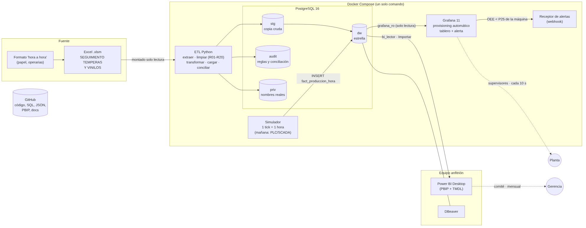

# 7. Arquitectura, consumo, evolución y seguridad

## 7.1 Arquitectura de extremo a extremo

| Capa | Componente | Contenedor | Detalle |
|---|---|---|---|
| Fuente | Excel `.xlsm` | (montado en `etl`) | Solo lectura; nunca se copia a la imagen |
| Integración | ETL Python | `bi_etl` | Corre una vez al levantar; reproducible desde cero |
| Almacenamiento | PostgreSQL 16 | `bi_db` | Esquemas `stg`, `dw`, `audit`, `priv`; volumen `pgdata` |
| Streaming | Simulador | `bi_simulador` | Inserta 1 hora de producción por máquina cada 30 s |
| Monitoreo | Grafana 11 | `bi_grafana` | Fuente de datos, tablero y alerta **aprovisionados** (sin clics); volumen `grafana-data` |
| Notificación | Receptor webhook | `bi_alertas` | Muestra en su log cada alerta que envía Grafana |
| Análisis | Power BI Desktop, DBeaver | Equipo anfitrión | Se conectan a `localhost:5432` |
| Versionamiento | GitHub | — | SQL, ETL, JSON de Grafana, PBIP, docs; sin `.env` ni datos |

## 7.2 Power BI vs. Grafana: por qué son complementarios y no se intercambian

| | **Power BI** (analítico) | **Grafana** (operativo) |
|---|---|---|
| Pregunta | ¿Por qué perdimos OEE este año y dónde invertimos? | ¿Qué máquina está fallando **ahora**? |
| Usuario | Alta dirección, gerente de planta, coordinador de mantenimiento | Supervisores de turno, técnicos de mantenimiento |
| Datos | Histórico completo 2022-2025 (`fact_produccion_turno`, `fact_paro`, `fact_tiempo_no_programado`) | Últimas horas (`fact_produccion_hora`) |
| Actualización | Cuando corre el ETL (mensual; podría ser diaria) · modo Importar | Cada 10 s · consulta directa a la base |
| Fortalezas | Modelo semántico, DAX, inteligencia de tiempo, *drill-down*, narrativa | Series de tiempo, estado actual, **alertas con notificación**, pantallas de planta |
| Debilidad si se usara para lo otro | Power BI no está hecho para refrescar cada pocos segundos ni para alertar a un técnico de turno | Grafana no tiene modelo semántico, jerarquías ni comparativos año contra año cómodos |

## 7.3 Evolución: datos directos desde PLC / SCADA

1. **Captura automática**: contadores de unidades y señales de marcha/paro de cada línea vía **OPC UA** (estándar de los PLC Siemens/Allen-Bradley) o **MQTT** (Sparkplug B) desde un *gateway* de borde (Node-RED, Kepware, Ignition Edge).
2. **El simulador se reemplaza** por un servicio que se suscribe al broker MQTT y escribe en `fact_produccion_hora` — la tabla y Grafana **no cambian**; solo cambia quién inserta. Granularidad mayor: un registro por minuto o por evento.
3. **Base de series de tiempo**: con lecturas por segundo conviene **TimescaleDB** (extensión de PostgreSQL: mismo SQL, *hypertables* y agregados continuos) para conservar la base actual.
4. **La operaria solo clasifica el paro**: el PLC detecta el paro y su duración exacta; la operaria elige el código/subcódigo en una tableta (HMI). Se eliminan el papel, la digitación y los errores tipo "pacas = unidades".
5. **Calidad real**: un sensor de rechazo (visión artificial o balanza) cuenta unidades malas → el componente Calidad deja de ser un *proxy*.
6. **ETL incremental** (CDC) en lugar de recarga total, y Power BI en *refresh* programado desde el servicio de Power BI con *gateway*.
7. **Alertas inteligentes**: además del umbral fijo, detección de anomalías (p. ej. caída de velocidad sostenida) y escalamiento por turno.

## 7.4 Datos personales y seguridad de acceso

Marco: **Ley 1581 de 2012** (habeas data) y Decreto 1377 de 2013. Los nombres de operarias y técnicos son datos personales; asociados a su desempeño pueden afectar su situación laboral.

| Medida | Implementación |
|---|---|
| **Seudonimización** | `dw.dim_persona` solo tiene `OP-007` / "Operaria 007". El nombre real queda en `priv.persona_identidad`. |
| **Mínimo privilegio** | Roles separados: `etl_admin` (dueño), `bi_lector` (solo `dw` y `audit`, transacciones de solo lectura), `grafana_ro` (solo las vistas de monitoreo), `simulador` (solo INSERT en `fact_produccion_hora`). Nadie fuera del ETL puede leer `priv`. |
| **Minimización** | Grafana no muestra personas. Power BI muestra seudónimos; el análisis por operaria es para capacitación, no sanción, y se recomienda agregarlo por turno. |
| **Secretos** | Contraseñas solo en `.env` (excluido de Git); se publica `.env.example` con valores de ejemplo. |
| **Fuente cruda** | `data/raw/*.xlsm` excluido de Git si el repositorio es público. El PBIP no guarda datos (la caché `.abf` está en `.gitignore`). |
| **Tableros** | Grafana sin registro libre ni acceso anónimo; usuario administrador desde `.env`. En producción: roles *Viewer* para supervisores, HTTPS detrás de un *reverse proxy* y SSO corporativo. Power BI: publicar en un área de trabajo con acceso por grupo y, si se desea, **RLS** por área (p. ej. cada jefe ve su línea). |
| **Trazabilidad** | `audit.etl_corrida` guarda fecha y SHA-256 del archivo cargado: se sabe con qué versión del Excel se generó cada informe. |
| **Retención** | Recomendación: conservar el nombre real solo mientras exista relación laboral y finalidad documentada. |
